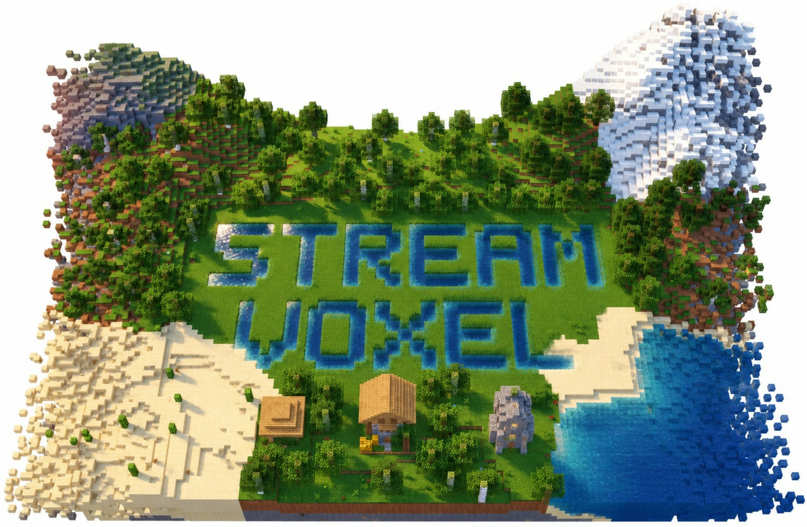
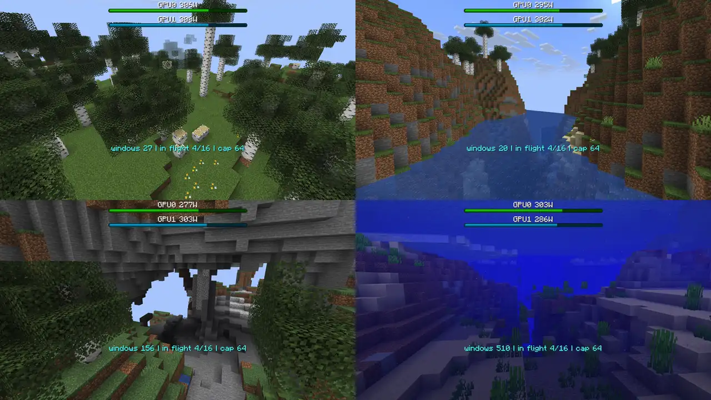
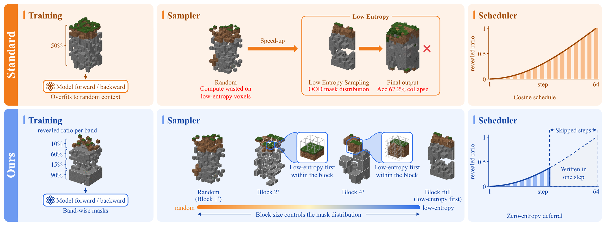

<h1 align="center">StreamVoxel</h1>

<b>Real-Time Streaming Generation of Unbounded Voxel Worlds with Masked Diffusion</b>

## Overview

StreamVoxel generates an unbounded voxel world one full-height column (16 × 16 × 256 blocks) at a time with masked diffusion, in the order the user explores it, and never changes a column once it is written. A multi-scale model reads nearby columns in detail and distant ones in summary at constant cost per column, the EASE sampler skips near-certain voxels to save forward passes, and a streaming system with step-level batching serves the columns nearest to the user. On two RTX 4090 GPUs it generates about 2 × 105 voxels per second, enough to follow a walking user.

One live session on two RTX 4090 GPUs, 6.5 minutes shown at 2× speed. Floating fragments at the edge of the view are columns that are still being filled.

Four live sessions at real-time speed, each serving the user from two RTX 4090 GPUs. The bars at the top show the power draw of each GPU.

## Method

Masked diffusion applied to space has an uneven entropy distribution: some voxels (open air above the terrain, deep fill) are nearly determined, others (surface, structures) are not.

1. **Multi-scale voxel world generation model.** A frozen masked-diffusion transformer (patch-4 DiT, MD4) generates one column. A trainable ControlNet branch reads, through cross-attention, the eight neighbouring columns at 4³ resolution, a wider area at 16³ resolution, and the biome map. The context has a fixed size, so the cost per column does not grow with the world.
2. **EASE (Entropy-Aware Skipping of Easy voxels).** *Fine-tuning:* i.i.d. random masks give the model random contexts at training time, while inference reveals contexts with spatial structure. Stage 2 fine-tunes with a half-mask recipe: half of the ranks use random masks, half use height-strata masks (bands of 8 layers, each band with its own noise level), and the model is converted to time-free. *Sampler:* 4³ block-wise low-entropy selection (random block order, entropy-ranked quota inside a block) plus low-entropy-last: after one marking forward, positions that are almost determined are committed at the very end with zero extra forwards. The block size interpolates between random decoding and global low-entropy decoding.
3. **Real-time streaming system.** Dependency-safe window admission (Chebyshev distance >= 2 to every in-flight window), continuous slot batching (8 slots per GPU, 2 GPUs), FlexAttention over variable-length conditions with cached K/V, selection without host synchronisation inside CUDA graphs, and elastic workers that can join or leave a running session.

## Results

Streaming expansion from a 32² start region to 256² columns, the main result of the paper (64 worlds):

| Method | Forward passes / column | Accuracy ↑ | VAE distance ↓ | LPIPS ↓ |
| --- | ---: | ---: | ---: | ---: |
| Dream-Cubed p4 | 480 | 0.5074 | 0.9170 | 0.4752 |
| Ours, random order | 32 | 0.7069 | 0.7289 | 0.3059 |
| Ours, block 4³ | 32 | 0.7375 | 0.6784 | 0.2783 |
| **Ours, fine-tuned + EASE** | **25.5** | **0.7330** | **0.6857** | **0.2774** |

Without any condition, rendered FID drops from 54.35 (Dream-Cubed) to 10.68 on 32³ chunks.

## Models

| Model | Description | Download |
| --- | --- | --- |
| Base model | Time-free masked-diffusion transformer (patch-4 DiT), fine-tuned with EASE. Generates one column. | Coming soon |
| ControlNet | Multi-scale context branch: neighbouring columns at 4³, a wider area at 16³ and the biome map. Requires the base model. | Coming soon |

## License

Code is released under the [MIT License](LICENSE). Minecraft is a trademark of Mojang AB; this project is not affiliated with Mojang or Microsoft.

